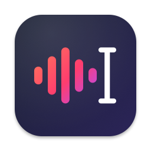
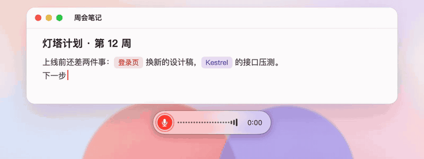
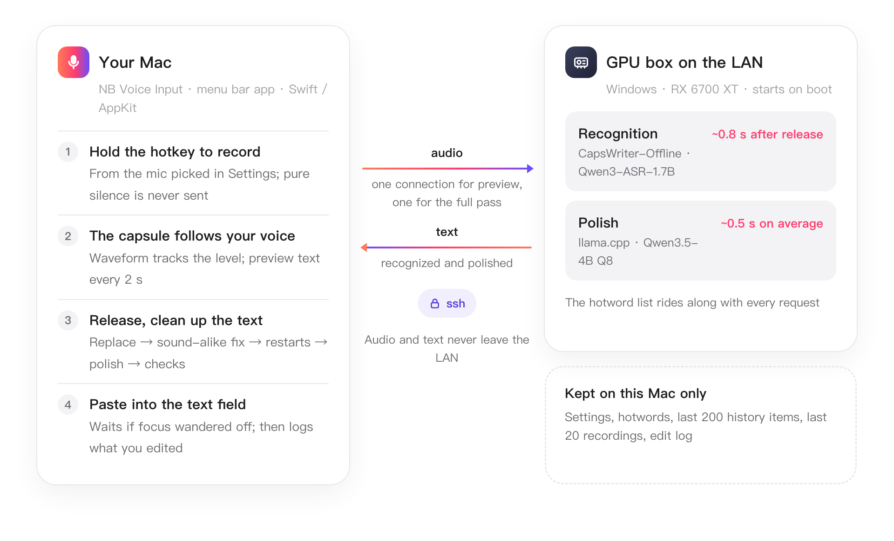
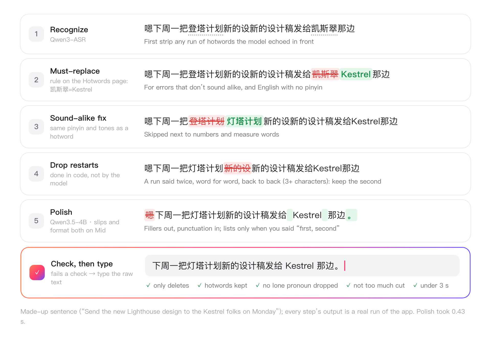
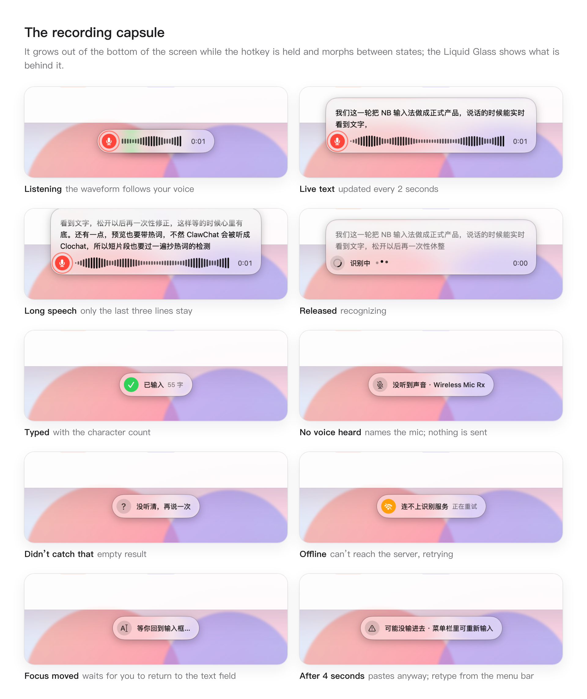
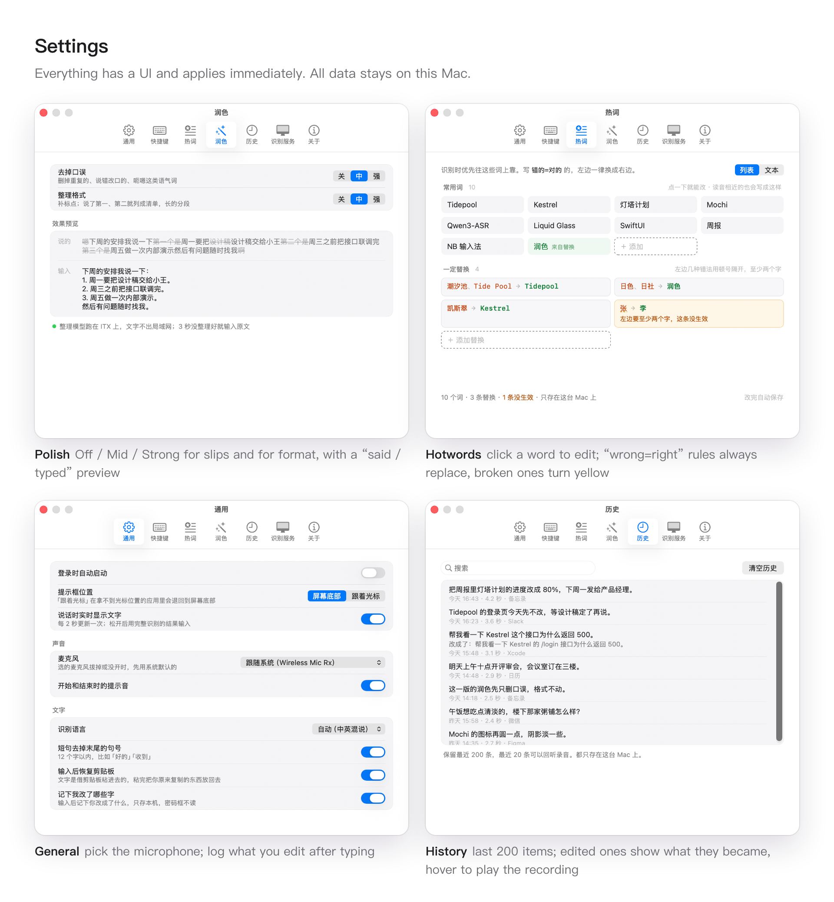

<p align="center">
  
</p>

<h1 align="center">NB 输入法 · NB Voice Input</h1>

<p align="center">
  Hold to talk, release to type. A macOS voice input method built for exactly one person's setup: mine.<br>
  <b>It is not a product to install. It is context to hand to your AI.</b>
</p>

<p align="center">
  <a href="README.md">简体中文</a> · <b>English</b> · <a href="README.ja.md">日本語</a>
</p>

<p align="center">
  
  
  
  
</p>

<p align="center">
  
</p>

> The app's UI, the docs in `docs/`, and the commit messages are in Chinese. Modern AI coding tools read them fine, which is the point: hand them the whole repo.

## Build your own software

> Tomorrow's tools may not be one-click installs. They may be context you hand to an AI.

NB has two goals, in this order:

1. **First: the voice input method that fits me best.** It serves one environment only: a Mac, plus a GPU machine on my LAN that runs speech recognition. I speak a mix of Chinese and English and keep naming things from my own projects. Every iteration happens because something felt clumsy in my own daily use, not to turn this into a product worth shipping. I will keep changing it however I like.
2. **Second: share the result as context.** Cloned as is, it most likely won't run for you. But if you want to build a voice input method of your own, give this repo to your AI coding tool (Claude Code, Codex, Cursor…) and let it use the decisions, measurements and mistakes recorded here to build **your** version for **your** setup.

So please treat it as reference material, not as software.

## Why not use a free voice input app?

Free voice input apps are already good. I built my own anyway, for two reasons:

- **Privacy.** Audio and text stay on my home network and are never uploaded to anyone's server.
- **In my working environment, a self-hosted service is clearly better and more stable.** Recognition runs on a GPU machine that serves only me: no queues, no rate limits, no internet hiccups. The full result arrives about 0.8 s after release, and polish adds about 0.5 s on average. The hotword list holds the names from my own projects, and the hotkeys and polish strength are tuned to my habits.

An online product serves millions of people, so it has to balance scale, cost and experience, and design for the average user. NB doesn't have to make that trade-off: it serves one person, so every choice comes down to whether it feels right to me.

## How it works

The client only records, shows and types. Recognition and polish run on a GPU box on the home network, reached through an ssh tunnel, so audio and text never leave the house.

<p align="center">
  <picture>
    <source media="(prefers-color-scheme: dark)" srcset="design/readme/arch-en-dark.png">
    
  </picture>
</p>

The recognized text is not pasted as is. It goes through a few steps on the Mac first, each one logged. The sentence below is made up, but every step's output is a real run of the app:

<p align="center">
  <picture>
    <source media="(prefers-color-scheme: dark)" srcset="design/readme/pipeline-en-dark.png">
    
  </picture>
</p>

## What it looks like

<p align="center">
  <picture>
    <source media="(prefers-color-scheme: dark)" srcset="design/readme/capsule-states-en-dark.png">
    
  </picture>
</p>

<p align="center">
  <picture>
    <source media="(prefers-color-scheme: dark)" srcset="design/readme/settings-en-dark.png">
    
  </picture>
</p>

The menu-bar icon is the status: red while recording, cycling while recognizing, gray when offline. Clicking the latest item in the menu types it again; items under 最近识别 (Recent) are copied instead.

## Use it as context

**Just want a working one first?** Open your AI coding tool (Claude Code, Codex, Cursor…) and send it this whole block; it clones the repo itself:

```text
https://github.com/libin1528/nb-ime is a macOS voice input method someone built
only for themselves (hold a hotkey to talk, release to type). Clone it, then
follow its docs/setup-with-agent.md to set up a working version on this Mac
for me: read that and the README first, ask me everything you need in one go,
pick the simplest path for me (macOS's built-in offline recognition if I have
no GPU machine), then build, configure and verify each step yourself. Only hand
me what I must do by hand, like granting permissions and pressing the hotkey.
Talk to me in English.
```

No GPU machine needed: macOS 26's built-in offline recognition handles Mandarin, Cantonese, English, Japanese, Korean and five European languages, and the guide (in Chinese, which your agent reads fine) explains how to plug it in.

To build a version of your own instead, say something like:

```text
https://github.com/libin1528/nb-ime is a macOS voice input method someone built
for themselves. Clone it and read the README, docs/ and the git log first, and
work out why each feature is built the way it is and which pitfalls they hit.
Then help me build a version for me: I want recognition to run on ____,
I mostly speak ____, and the feature I want most is ____.
```

Suggested reading order, for humans and AIs alike:

| Read | What's inside |
|---|---|
| [`docs/setup-with-agent.md`](docs/setup-with-agent.md) | Setup guide for your AI: what to ask, which path to take, how to verify each step, common pitfalls |
| [`docs/`](docs/) | One brief and log per iteration: decisions made, measured data and conclusions, pitfalls |
| `git log` | Every commit says what changed and why; read in order, it is the story of how the project grew |
| [`design/`](design/) | Mockups, before/after screenshots for each iteration, the polish before/after page |
| [`client-mac/Sources/`](client-mac/Sources/) | Swift code split by feature; see "What's worth borrowing" below |
| [`server/`](server/) | How the server is deployed and auto-started, and the Windows pitfalls |

## My setup

Knowing what it was written for tells you what to swap out:

| | Mine | You will probably change |
|---|---|---|
| Client | macOS 26, native Swift / AppKit, menu-bar app, no third-party dependencies | OS version (the capsule uses Liquid Glass) |
| Recognition | A Windows GPU box on the LAN (RX 6700 XT) running [CapsWriter-Offline](https://github.com/HaujetZhao/CapsWriter-Offline) + Qwen3-ASR-1.7B | Where recognition runs: on-device, a cloud API, another model |
| Connection | The Mac connects through an ssh tunnel; audio never leaves the house | Plain LAN, or no server at all |
| Polish | Qwen3.5-4B 8-bit on llama.cpp, on the same box | Whether to polish, and with which model |
| Microphone | A USB wireless mic, picked explicitly in Settings | Your mic; recognition gets much worse when the input is too quiet |
| Speech | Mixed Chinese and English, lots of project names, backed by a hotword list | Your languages, your vocabulary |
| UI language | Chinese only | — |

## What's worth borrowing

| Feature | Code | What to look at |
|---|---|---|
| Recording capsule | [`Capsule.swift`](client-mac/Sources/Capsule.swift) | System `NSGlassEffectView` (clear glass with a thin contrasting backing under the text); grows from a dot into a capsule and morphs continuously between states; the waveform follows the input level and the capsule expands upward with live text |
| Global hotkeys | [`Hotkey.swift`](client-mac/Sources/Hotkey.swift) | A CGEventTap on keyboard and mouse: a lone modifier, an F key or a mouse side button can be the hotkey, two at once; re-syncs with the real key state after the system disables the tap |
| Recording and microphone | [`Audio.swift`](client-mac/Sources/Audio.swift) · [`Recordings.swift`](client-mac/Sources/Recordings.swift) | Follow the system mic or pick one, refreshed on plug/unplug; `AVAudioEngine` only knows the device it was built with, so it is rebuilt when the device changes. Pure silence (below -55 dB) is never sent; the last 20 recordings are kept as wav and can be played from History |
| Streaming preview | [`AppController.swift`](client-mac/Sources/AppController.swift) | The same audio goes over two WebSockets: one gives a preview every 2 s, the other the full result after release, which is what gets typed |
| Hotwords and must-replace rules | [`WordsPane.swift`](client-mac/Sources/WordsPane.swift) · [`Replace.swift`](client-mac/Sources/Replace.swift) | The Hotwords tab is a click-to-edit list by default, or plain text one per line; `wrong=right` always replaces, whole words only, longest first, one pass; a broken rule turns yellow and says why |
| Hotword fix by pronunciation | [`Hotfix.swift`](client-mac/Sources/Hotfix.swift) | When the model writes 万三 but it sounds like the hotword "Wan3", swap it back; Chinese hotwords must match tones too, and spans next to numbers or measure words are left alone |
| Guard against hotword echo | `strippedEcho` in [`Settings.swift`](client-mac/Sources/Settings.swift) | If the whole result is hotwords, re-recognize with them reversed; if a run of them (4+ in prompt order from the first one) was copied in front of the real words, cut it |
| Post-recognition polish | [`Polish.swift`](client-mac/Sources/Polish.swift) | "Remove slips" and "Tidy format", each Off / Mid / Strong. Word-for-word restarts are removed in code before the model sees the text; the small model's output is never trusted: it must pass a "delete only, keep every hotword, no lone pronoun dropped, not too much cut" check, or the raw text is typed instead |
| Check focus before pasting | [`AppController.swift`](client-mac/Sources/AppController.swift) | Remembers the focused element when the hotkey goes down; if focus moved somewhere you can't type, waits for it to come back (up to 4 s), and the menu bar can type it again |
| Edit log | [`Edits.swift`](client-mac/Sources/Edits.swift) | After pasting, watches that text field through the Accessibility API and records what you changed the text into, locally only, as data for future tuning; password fields are skipped, Electron apps are asked to turn on their accessibility tree first |
| Menu bar, settings, onboarding | [`MenuBar.swift`](client-mac/Sources/MenuBar.swift) · [`SettingsWindow.swift`](client-mac/Sources/SettingsWindow.swift) · [`Onboarding.swift`](client-mac/Sources/Onboarding.swift) | The menu-bar icon is the status: red while recording, cycling while recognizing, gray when offline; every setting has a UI |

Settings › 通用 (General) › 声音 (Sound) has a “Lower playing audio while speaking” switch (off by default). On hotkey down, a background check detects other apps’ audio and fades system volume to zero over about 0.15 seconds, without waiting for microphone startup or the hold threshold. That recording skips its start cue; otherwise cues work normally. Release raises the volume for the end cue, then fades back over 1.25 seconds. Playback continues without player commands. See the [implementation notes](docs/2026-11-05-duck-volume.md).

## Measured, and learned the hard way

Each of these is a line or two of code, and each came from a measurement or a failure. Details are in [`docs/`](docs/) and the commit history:

- **The server buffers audio per connection, not per task.** Preview and full recognition need separate WebSockets; sharing one mixes the audio and the full result comes back empty.
- **When the voice is too quiet or there is only silence, the ASR model reads the hotword list from its prompt back as the transcript.** Detect it and re-recognize with the hotwords in reverse order to confirm. Previews do it too, yet previews without hotwords get proper nouns wrong, so both sides need handling. When the start of a recording is quiet, it may also paste the whole list in front of the real words (3 times in 20 runs of the same clip), which needs catching too.
- **"Recognition got worse" is usually the microphone, not the model.** A wireless mic receiver sends pure silence when the transmitter is off or too far; before fixing it, speech peaked at -47 dB, after it around -30 dB, and the errors went away. So silence is never sent: the capsule says "no voice heard" with the mic's name, and the recording is kept for playback.
- **`AVAudioEngine` sticks to the device it was built with,** even after the system default changes, so rebuild it and set the device explicitly; tap with the mic's own `inputFormat`, since `outputFormat` throws when input and output sample rates differ; when stopping, stop the engine before removing the tap, or it crashes.
- **2-second preview segments are the sweet spot:** 1 to 1.5 s behind speech; 3 s is more accurate but updates too slowly.
- **Global `NSEvent` monitors don't see lone modifier presses,** so it uses a CGEventTap. Key presses simulated by an AI are dropped by the system, so hotkeys can only be tested by a human hand, with the log as the judge.
- **Rebuilding loses the Accessibility permission** unless you sign with the same development certificate from your keychain; changing the bundle id loses it too.
- **Clear glass without a backing makes text unreadable on dark backgrounds in light mode.** `tintColor` barely does anything, so the capsule draws its own thin contrasting layer.
- **The small polish model sometimes adds or changes characters.** Rather than fighting it in the prompt, check the output mechanically: added text, a lost hotword, a dropped pronoun, too much deleted, or a timeout all fall back to the raw text. Whatever code can do reliably (word-for-word restarts) should not be left to the model.
- **A simulated ⌘V is lost if focus isn't in a text field at that moment;** the user sees "typed" and nothing appears. Remember the focus on key-down and check it before pasting.
- **Electron apps don't expose their accessibility tree by default,** so the text field can't be read; set `AXManualAccessibility` on the app once, then read again.
- **llama.cpp on Windows without `--no-mmap`** takes 5.7 GB of RAM for a 4B model; with it, 834 MB.
- **On Windows, `schtasks /end` only ends the main process.** The recognition child process lives on as an orphan holding GPU memory; after a few restarts the GPU is full and recognition goes from 0.4 s to several seconds. Scheduled tasks also default to priority 7 (below normal), so a busy machine pushes recognition back and pages it out first; set it to 2.

## Running it yourself

<details>
<summary>Running it my way: a GPU machine for the recognition server, macOS 26, building from source. Expand for steps (no GPU machine? have your AI follow <code>docs/setup-with-agent.md</code>).</summary>

<br>

1. **Server**: install CapsWriter-Offline and the Qwen3-ASR model on a machine with a GPU; see [`server/README.md`](server/README.md) (ours is Windows; the guide is in Chinese). Polish needs Qwen3.5-4B running as well, covered in the same guide; or skip it and turn both options off in Settings › 润色 (Polish).
2. **Client**: needs macOS 26 and the Xcode command line tools.
   ```bash
   cd client-mac && ./build.sh
   ```
   This installs `~/Applications/NB 输入法.app` and launches it. To keep the Accessibility permission across rebuilds, put the name of a development certificate from your keychain in `client-mac/sign-identity.local`; without it the app is ad-hoc signed.
3. On first launch it walks you through the microphone and Accessibility permissions; then enter your ssh host or server address in Settings › 识别服务 (Recognition). The defaults match our own machines.

This is my personal tool: no feature requests, no promise of maintenance, issues may go unanswered. Fork it, or better, have your AI write your own.

</details>

<details>
<summary>Layout, local data and debug commands</summary>

<br>

| Folder | Contents |
|---|---|
| `client-mac/` | The menu-bar client (Swift / AppKit, one file per feature under `Sources/`). `./build.sh` builds, installs and launches; `--no-run` installs only, `--icon` redraws the icon |
| `server/` | Deployment notes for the server (CapsWriter-Offline and the polish model) and Windows auto-start scripts |
| `tools/` | Debug scripts, e.g. `stream_test.py` for the streaming preview and `hotword_echo_test.py` for comparing hotword prompts |
| `design/` | The mockup `mockup.html`, before/after screenshots per iteration, the polish comparison page `polish/samples.html`, the Hotwords tab mockup `hotwords/`, the homepage images and their sources `homepage/` (re-render with `src/render.sh`) |
| `docs/` | Brief and log for each iteration |

Local data lives in `~/Library/Application Support/NBIME/`: settings `config.json`, hotwords `hotwords.txt`, history `history.json` (last 200), all editable in the settings window; the last 20 recordings are in `recordings/`, the edit log in `edits/edits.jsonl` (recordings of edited items are kept in `edits/`, up to 300). The log is `~/Library/Logs/NBIME.log`, one line per step: replacement, sound-alike fix, dropped restart, polish, how long it waited for focus.

Debugging:

- `NBIME --test-file <audio>`: no microphone; sends the file at real-time pace through the same path (including the preview) and prints `PREVIEW` / `RESULT`.
- `NBIME --demo <screen>`: for screenshots: `listen` `quiet` `preview` `long` `think` `done` `miss` `offline` `nosound` `morph` (the full morph sequence) `menu` `onboarding` `settings:0`…`settings:6`.
- `NBIME --polish-test <file>`: one sentence per line, each run through all 8 polish level combinations, one JSON line per run (`--levels 中中,强强` runs only those). Run it before and after changing the prompt.
- `NBIME --edit-test <text just typed> [--seconds N]`: pretends that text was just pasted into the focused field, watches it for N seconds and logs the edit, without saving it. Launch the installed app with `open -g -n -a` (the Accessibility permission belongs to the app).
- These modes reuse the tunnel if it is already up and leave it alone.

</details>

## Open-source projects used

| Project | Used for | License |
|---|---|---|
| [CapsWriter-Offline](https://github.com/HaujetZhao/CapsWriter-Offline) | Recognition server; the client speaks its WebSocket protocol | MIT |
| [Qwen3-ASR](https://github.com/QwenLM/Qwen3-ASR) | Speech recognition model (1.7B; the q5_k quantization ships with CapsWriter's model pack) | Apache-2.0 |
| [Qwen3.5-4B](https://huggingface.co/Qwen/Qwen3.5-4B) | Small model for polish ([unsloth](https://huggingface.co/unsloth/Qwen3.5-4B-GGUF)'s Q8_0 quantization) | Apache-2.0 |
| [llama.cpp](https://github.com/ggml-org/llama.cpp) | `llama-server` for the polish model (the Vulkan build bundled with CapsWriter) | MIT |
| [websockets](https://github.com/python-websockets/websockets), [NumPy](https://github.com/numpy/numpy) | Debug scripts in `tools/` | BSD-3-Clause |

None of these are bundled in this repo; download them from the original projects under their own licenses. Design references: Apple's Liquid Glass and the WeChat Input Method menus.

## License

[MIT](LICENSE). Take the code, docs and screenshots and change them however you like; no need to ask.
