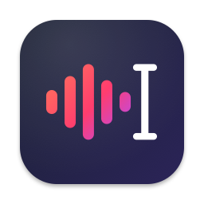
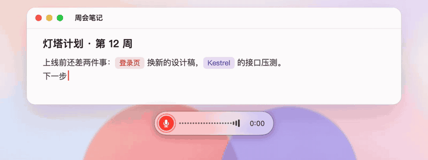
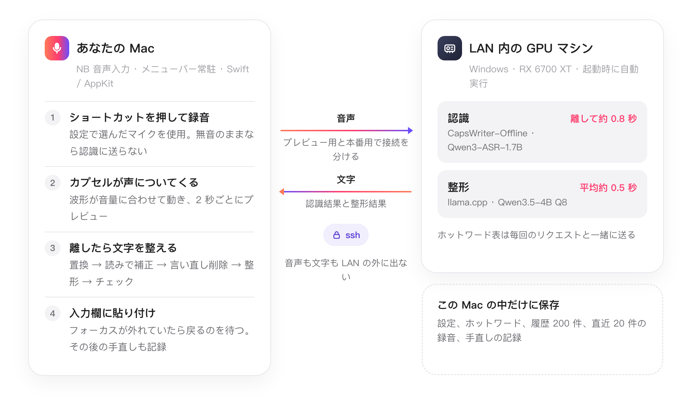
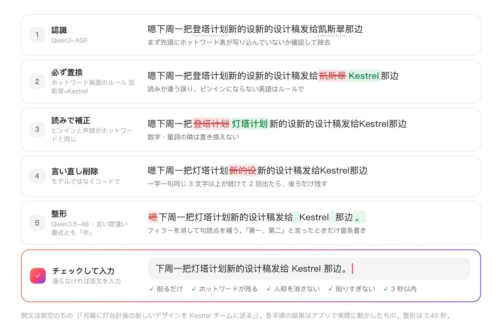
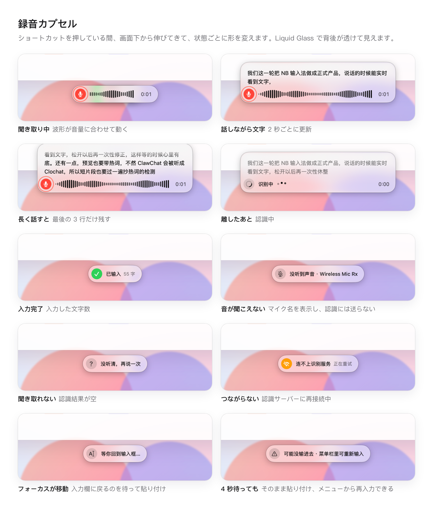
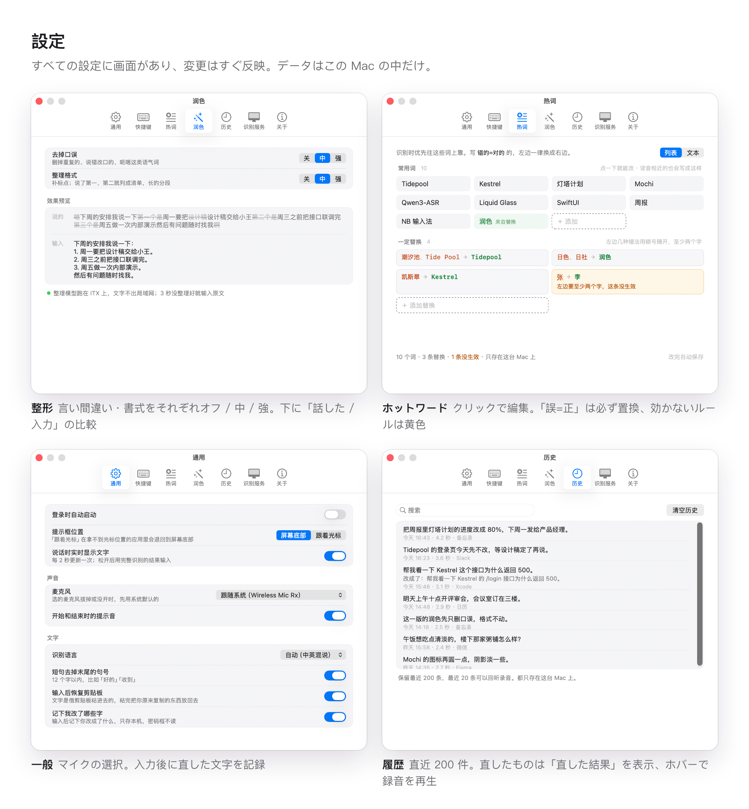

<p align="center">
  
</p>

<h1 align="center">NB 输入法 · NB 音声入力</h1>

<p align="center">
  押して話し、離すと入力。自分の環境だけのために作った Mac 用の音声入力です。<br>
  <b>そのまま使う製品ではなく、AI に渡すための「コンテキスト」です。</b>
</p>

<p align="center">
  <a href="README.md">简体中文</a> · <a href="README.en.md">English</a> · <b>日本語</b>
</p>

<p align="center">
  
  
  
  
</p>

<p align="center">
  
</p>

> アプリの画面、`docs/` の記録、コミットメッセージは中国語です。最近の AI コーディングツールなら問題なく読めます。リポジトリごと渡してください。

## ソフトウェアは自分で作る

> これからのツールは、ワンクリックで入れる完成品とは限らない。AI に渡せるコンテキストかもしれない。

NB には目的が二つあり、優先順位があります。

1. **第一に、自分にいちばん合う音声入力を作ること。** 対象は私の環境だけです。Mac が一台と、LAN 内で音声認識を動かす GPU マシンが一台。話すときは中国語と英語が混ざり、自分のプロジェクトの固有名詞がたくさん出てきます。改良はいつも、自分で使っていて不便だったところから始まります。公開に値する製品にするためではありません。これからも自分の考えで手を入れ続けます。
2. **第二に、その成果をコンテキストとして共有すること。** そのまま clone しても、たぶん動きません。でも自分の音声入力を作りたいなら、このリポジトリを AI コーディングツール（Claude Code、Codex、Cursor など）に渡してください。ここに残した判断、実測データ、ハマりどころを参考に、**あなたの**環境に合った**あなたの**版を作らせるのが狙いです。

ソフトウェアではなく、参考資料として扱ってください。

## なぜ無料の音声入力を使わないのか

無料の音声入力アプリはもう十分に便利です。それでも自分で組んだ理由は二つあります。

- **プライバシー。** 音声も文字も自宅の LAN の中だけを流れ、誰のサーバーにもアップロードされません。
- **私の作業環境では、自前のサービスのほうが明らかに使い心地がよく、安定している。** 認識は私専用の GPU マシンで動くので、順番待ちも回数制限もなく、外のネットワークの揺らぎにも左右されません。離してから約 0.8 秒で完全な結果が出て、整形は平均でさらに約 0.5 秒。ホットワード表には自分のプロジェクトの名前が入り、ホットキーも整形の強さも自分の癖に合わせてあります。

オンラインの製品は何百万人もの利用者に向けて、規模・コスト・体験の釣り合いを取り、平均的なユーザーに合わせるしかありません。NB はその取捨選択をしなくていい。使うのは私一人なので、どの判断も「自分にとって使いやすいか」だけで決められます。

## しくみ

クライアントは録音・表示・入力だけ。認識と整形は家の LAN にある GPU マシンで動き、ssh トンネル経由でつなぐので、音声も文字も家の外に出ません。

<p align="center">
  <picture>
    <source media="(prefers-color-scheme: dark)" srcset="design/readme/arch-ja-dark.png">
    
  </picture>
</p>

認識結果はそのまま貼り付けず、まず Mac の上でいくつかの手順を通し、各手順はログに残ります。下の例文は架空ですが、各手順の結果はアプリで実際に動かしたものです。

<p align="center">
  <picture>
    <source media="(prefers-color-scheme: dark)" srcset="design/readme/pipeline-ja-dark.png">
    
  </picture>
</p>

## 見た目

<p align="center">
  <picture>
    <source media="(prefers-color-scheme: dark)" srcset="design/readme/capsule-states-ja-dark.png">
    
  </picture>
</p>

<p align="center">
  <picture>
    <source media="(prefers-color-scheme: dark)" srcset="design/readme/settings-ja-dark.png">
    
  </picture>
</p>

メニューバーのアイコン自体が状態表示です：録音中は赤、認識中は順に点灯、未接続はグレー。メニューの最新の一件をクリックするともう一度入力し、「最近识别」（最近の認識）の中の項目はコピーになります。

## コンテキストとして使う

**まずは動くものがほしい？** AI コーディングツール（Claude Code、Codex、Cursor など）を開き、次のブロックをそのまま送ってください。clone も AI がやります。

```text
https://github.com/libin1528/nb-ime は、ある人が自分のためだけに作った
Mac の音声入力です（ショートカットを押して話し、離すと入力）。これを clone して、
中の docs/setup-with-agent.md に沿ってこの Mac で使える版を作って：
まずそれと README を読み、聞きたいことは一度にまとめて聞き、
いちばん手軽な道を選び（GPU マシンがなければ macOS 内蔵のオフライン認識）、
ビルド・設定・各手順の確認は自分でやって。権限の許可やショートカットを押すなど、
私が手でやるしかないことだけ私に渡して。私とは日本語で話して。
```

GPU マシンがなくても大丈夫です。macOS 26 内蔵のオフライン認識は日本語・中国語（普通話、広東語）・英語・韓国語と欧州の 5 言語に対応していて、その組み込み方はガイド（中国語ですが、AI は問題なく読めます）に書いてあります。

自分の考えで自分なりの版を作りたいなら、こう頼みます。

```text
https://github.com/libin1528/nb-ime は、ある人が自分用に作った Mac の音声入力です。
clone して、まず README、docs/、git log を読んで、各機能がなぜそう作られているか、
どこでハマったかを把握して。
そのうえで私に合う版を作るのを手伝って：認識は ____ で動かしたい、
よく話す言語は ____、いちばん欲しい機能は ____。
```

おすすめの読む順番（人にも AI にも）：

| まず読む | 中身 |
|---|---|
| [`docs/setup-with-agent.md`](docs/setup-with-agent.md) | AI 向けのセットアップガイド：何を聞くか、どの道を選ぶか、各手順の確かめ方、よくあるハマりどころ |
| [`docs/`](docs/) | 各イテレーションの作業指示と記録：決めたこと、実測データと結論、ハマりどころ |
| `git log` | どのコミットにも「何を、なぜ変えたか」が書いてあり、順に読めばプロジェクトの成長記録になる |
| [`design/`](design/) | モックアップ、各回の変更前後のスクリーンショット、整形の比較ページ |
| [`client-mac/Sources/`](client-mac/Sources/) | 機能ごとに分かれた Swift のコード。下の「参考になるところ」を参照 |
| [`server/`](server/) | サーバーのデプロイと自動起動、Windows でのハマりどころ |

## 私の環境

何を前提に書かれているかが分かれば、どこを差し替えればいいかも分かります。

| | 私の場合 | たぶん差し替えるところ |
|---|---|---|
| クライアント | macOS 26、ネイティブの Swift / AppKit、メニューバー常駐、サードパーティ依存なし | OS のバージョン（カプセルに Liquid Glass を使用） |
| 認識 | LAN 内の Windows GPU マシン（RX 6700 XT）で [CapsWriter-Offline](https://github.com/HaujetZhao/CapsWriter-Offline) + Qwen3-ASR-1.7B | 認識をどこで動かすか：Mac 上、クラウド API、別のモデル |
| 接続 | Mac から ssh トンネル経由。音声は家の外に出ない | LAN に直接、あるいはサーバーなし |
| 整形 | 同じマシンで llama.cpp により Qwen3.5-4B 8bit | 整形を使うか、どのモデルにするか |
| マイク | USB のワイヤレスマイクを設定で指定 | あなたのマイク。入力音量が小さいと認識がはっきり悪くなる |
| 話し方 | 中国語と英語が混在、固有名詞が多くホットワード表で補う | あなたの言語、あなたの語彙 |
| 画面の言語 | 中国語のみ | — |

## 参考になるところ

| 機能 | コード | 見どころ |
|---|---|---|
| 録音カプセル | [`Capsule.swift`](client-mac/Sources/Capsule.swift) | システムの `NSGlassEffectView`（clear ガラス＋文字の下に反転色の薄い下地）。点からカプセルに育ち、状態の間をひと続きに変形。波形は音量に追従し、話している間は上に広がって文字をリアルタイム表示 |
| グローバルホットキー | [`Hotkey.swift`](client-mac/Sources/Hotkey.swift) | CGEventTap でキーボードとマウスを監視。修飾キー単押し、F キー、マウスのサイドボタンもホットキーにでき、二つまで設定可能。システムにタップを止められた後は実際のキー状態に合わせ直す |
| 録音とマイク | [`Audio.swift`](client-mac/Sources/Audio.swift) · [`Recordings.swift`](client-mac/Sources/Recordings.swift) | システムに従うかマイクを指定、抜き差しで自動更新。`AVAudioEngine` は作ったときのデバイスしか使わないので、デバイスが変わったら作り直す。ずっと無音（-55 dB 未満）なら認識に送らない。直近 20 件の録音を wav で残し、履歴から再生できる |
| ストリーミングプレビュー | [`AppController.swift`](client-mac/Sources/AppController.swift) | 同じ音声を二本の WebSocket に流す。一本は 2 秒ごとのプレビュー、もう一本は離した後の完全な結果で、入力するのは後者 |
| ホットワードと「必ず置換」 | [`WordsPane.swift`](client-mac/Sources/WordsPane.swift) · [`Replace.swift`](client-mac/Sources/Replace.swift) | ホットワード画面は標準でクリックして直せる一覧、一行一語のテキストにも切り替え可能。`誤=正` と書けば必ず置換：単語単位、長いほうを優先、一回だけ。効かないルールはその場で黄色になり理由を表示 |
| 読みによるホットワード補正 | [`Hotfix.swift`](client-mac/Sources/Hotfix.swift) | モデルが「万三」と書いても、読みがホットワード「Wan3」と同じなら書き換える。中国語は声調まで一致が条件、数字や量詞に接する部分は触らない |
| ホットワード表の写り込み対策 | [`Settings.swift`](client-mac/Sources/Settings.swift) の `strippedEcho` | 結果が全部ホットワードなら逆順で認識し直す。本当の発話の前に一続き（先頭のホットワードから元の順で 4 個以上）写っていたら、その部分を除く |
| 認識後の整形 | [`Polish.swift`](client-mac/Sources/Polish.swift) | 「言い間違いを除く」「書式を整える」がそれぞれ オフ / 中 / 強。一字一句同じ言い直しはモデルに渡す前にコードで削る。小さなモデルの出力は信用せず、「削るだけで足さない、ホットワードは全部残る、人称を消さない、削りすぎない」チェックを通らなければ元の文を入力 |
| 貼り付け前のフォーカス確認 | [`AppController.swift`](client-mac/Sources/AppController.swift) | ショートカットを押した時点のフォーカスを覚えておき、貼り付け前に入力できない場所へ移っていたら戻るのを待つ（最大 4 秒）。メニューバーからもう一度入力もできる |
| 手直しの記録 | [`Edits.swift`](client-mac/Sources/Edits.swift) | 貼り付けた後、その入力欄をアクセシビリティ API で見守り、どう書き直したかを記録（この Mac の中だけ、今後の改善用のデータ）。パスワード欄は読まない。Electron アプリには先にアクセシビリティツリーを開いてもらう |
| メニューバー、設定、初回案内 | [`MenuBar.swift`](client-mac/Sources/MenuBar.swift) · [`SettingsWindow.swift`](client-mac/Sources/SettingsWindow.swift) · [`Onboarding.swift`](client-mac/Sources/Onboarding.swift) | メニューバーのアイコン自体が状態表示：録音中は赤、認識中は順に点灯、未接続はグレー。設定はすべて画面から変更できる |

「設定 › 通用（一般）› 声音（サウンド）」の「说话时压低正在播放的声音」は初期状態ではオフです。ホットキーを押すとバックグラウンドで他の App の音声出力を調べ、マイク起動や長押し判定を待たず約 0.15 秒で音量を 0 に下げます。その録音では開始通知音を省き、音量を下げない場合は通常どおり鳴らします。キーを離すと終了通知音が聞こえる音量に上げ、1.25 秒かけて元に戻します。再生は進み続け、プレーヤーにはコマンドを送りません。詳しくは[実装記録](docs/2026-11-05-duck-volume.md)を参照してください。

## 実測した結論と、ハマったところ

コードでは一、二行でも、どれも実測か失敗から出てきたものです。詳細は [`docs/`](docs/) とコミット履歴にあります。

- **サーバーの音声バッファはタスク単位ではなく接続単位。** プレビューと完全認識は別々の WebSocket が必要で、一本にまとめると音声が混ざり、完全な結果が空になる。
- **声が小さすぎるか無音だと、認識モデルがプロンプト内のホットワード表をそのまま読み上げる。** 検出したら、ホットワードを逆順にして認識し直して確かめる。プレビューでも起きるが、プレビューにホットワードを付けないと固有名詞を間違えるので、両方の対処が要る。録音の出だしの声が弱いと、本当の発話の前に表をまるごと写すこともある（同じ録音で 20 回中 3 回）ので、これも止める。
- **「認識が悪くなった」はたいていマイクのせいで、モデルではない。** ワイヤレスマイクの受信機は、送信機が切れていたり遠すぎたりすると無音しか送らない。調整前は話し声のピークが -47 dB、調整後は -30 dB 前後になり、誤字も消えた。だから無音は送らず、カプセルにマイク名つきで「声が聞こえない」と出し、録音も残して聞き直せるようにした。
- **`AVAudioEngine` は作ったときのデバイスにしがみつく。** システムの既定マイクが変わってもついてこないので、作り直してデバイスを明示する。tap にはマイク自身の `inputFormat` を使う（入出力のサンプルレートが違うと `outputFormat` では例外になる）。止めるときはエンジンを止めてから tap を外す。逆だと落ちる。
- **プレビューの区切りは 2 秒が釣り合う点：** 発話から 1〜1.5 秒遅れ。3 秒のほうが正確だが更新が遅すぎる。
- **`NSEvent` のグローバル監視では修飾キーの単押しを拾えない**ので CGEventTap を使う。AI が模擬したキー入力はシステムに捨てられるので、ホットキーは人の手で押してログで判定するしかない。
- **再ビルドすると「アクセシビリティ」の許可が外れる。** キーチェーンの同じ開発用証明書で署名すれば外れない。bundle id を変えても外れる。
- **clear ガラスに下地がないと、ライトモードで暗い背景の上の文字が読めない。** `tintColor` はほとんど効かず、反転色の薄い下地を自前で敷いた。
- **整形用の小さなモデルは、ときどき文字を足したり変えたりする。** プロンプトで粘るより、出力を機械的にチェックする。文字が増えた、ホットワードが消えた、人称を消した、削りすぎ、タイムアウトなら、すべて元の文に戻す。コードで確実にできること（一字一句同じ言い直し）はモデルに任せない。
- **⌘V を模擬した瞬間にフォーカスが入力欄になければ、何も入らない。** ユーザーには「入力済み」と見えるのに何もない。押した時点のフォーカスを覚えておき、貼り付け前に確かめる。
- **Electron アプリは標準ではアクセシビリティツリーを公開しない**ので入力欄の文字が読めない。アプリに一度 `AXManualAccessibility` を設定してから読み直す。
- **Windows の llama.cpp で `--no-mmap` を付けないと**、4B モデルでメモリを 5.7GB 使う。付ければ 834MB。
- **Windows の `schtasks /end` はメインプロセスしか終わらせない。** 認識の子プロセスが孤児になって GPU メモリを握り続け、何度か再起動すると GPU が埋まって認識が 0.4 秒から数秒になる。タスクスケジューラの既定の優先度 7（通常以下）だと、マシンが忙しいとき認識が後回しにされ、メモリも先に追い出されるので 2 にする。

## 自分で動かしてみる

<details>
<summary>私の環境どおりに動かす場合：認識サーバー用の GPU マシン、macOS 26、ソースからのビルド。開くと手順が出ます（GPU マシンがなければ AI に <code>docs/setup-with-agent.md</code> を渡してください）。</summary>

<br>

1. **サーバー**：GPU のあるマシンに CapsWriter-Offline と Qwen3-ASR モデルを入れます。手順は [`server/README.md`](server/README.md)（私たちのは Windows、説明は中国語）。整形を使うなら Qwen3.5-4B も動かします（同じ説明にあり）。使わない場合は「設定 › 润色（整形）」で両方をオフに。
2. **クライアント**：macOS 26 と Xcode コマンドラインツールが必要です。
   ```bash
   cd client-mac && ./build.sh
   ```
   `~/Applications/NB 输入法.app` に入れて起動します。再ビルドのたびにアクセシビリティを許可し直したくなければ、`client-mac/sign-identity.local` にキーチェーンの開発用証明書の名前を一行書いてください。なければアドホック署名になります。
3. 初回起動時にマイクとアクセシビリティの許可を案内します。その後「設定 › 识别服务（認識サービス）」で ssh ホストかサーバーのアドレスを入れます。初期値は私たちのマシンに合わせてあります。

これは私の個人用ツールです。機能要望は受け付けず、メンテナンスも約束しません。issue にも返事できないことがあります。fork するか、できれば AI に自分用を書かせてください。

</details>

<details>
<summary>ディレクトリ構成、ローカルデータ、デバッグ用コマンド</summary>

<br>

| ディレクトリ | 中身 |
|---|---|
| `client-mac/` | メニューバーのクライアント（Swift / AppKit、`Sources/` に機能ごとのファイル）。`./build.sh` でビルド・インストール・起動、`--no-run` はインストールのみ、`--icon` はアイコンを描き直す |
| `server/` | サーバー（CapsWriter-Offline と整形モデル）のデプロイ手順と Windows の自動起動スクリプト |
| `tools/` | デバッグ用スクリプト。ストリーミングプレビューを測る `stream_test.py`、ホットワードの渡し方を比べる `hotword_echo_test.py` など |
| `design/` | モックアップ `mockup.html`、各回の実画面の比較スクリーンショット、整形の比較ページ `polish/samples.html`、ホットワード画面のモックアップ `hotwords/`、トップページの画像とその元ファイル `homepage/`（`src/render.sh` で描き直し） |
| `docs/` | 各イテレーションの作業指示と記録 |

ローカルデータは `~/Library/Application Support/NBIME/` にあります：設定 `config.json`、ホットワード `hotwords.txt`、履歴 `history.json`（直近 200 件）。どれも設定画面から変更できます。直近 20 件の録音は `recordings/`、手直しの記録は `edits/edits.jsonl`（直した分の録音は `edits/` に最大 300 件）。ログは `~/Library/Logs/NBIME.log` で、置換、読みの補正、言い直しの削除、整形、フォーカスを何秒待ったかまで一手順ずつ一行に記録します。

デバッグ：

- `NBIME --test-file <音声>`：マイクを使わず、実時間のペースで同じ送信経路（プレビュー含む）を通し、`PREVIEW` / `RESULT` を出力。
- `NBIME --demo <画面>`：スクリーンショット用。`listen` `quiet` `preview` `long` `think` `done` `miss` `offline` `nosound` `morph`（変形の一連の流れ）`menu` `onboarding` `settings:0`…`settings:6`。
- `NBIME --polish-test <ファイル>`：一行一文。各文を整形の 8 通りの組み合わせで実行し、一回ごとに JSON を一行出力（`--levels 中中,强强` で指定した組み合わせだけ）。プロンプトを変える前後で比べるのに使う。
- `NBIME --edit-test <入力したばかりの文字> [--seconds N]`：その文字をフォーカス中の入力欄に貼ったことにして N 秒見守り、手直しの結果をログに書く（記録には入れない）。インストール済みのアプリを `open -g -n -a` で起動すること（アクセシビリティの許可はアプリに付く）。
- これらのモードは、すでに張られているトンネルを借りるだけで触りません。

</details>

## 使っているオープンソース

| プロジェクト | 用途 | ライセンス |
|---|---|---|
| [CapsWriter-Offline](https://github.com/HaujetZhao/CapsWriter-Offline) | 認識サーバー。クライアントはその WebSocket プロトコルで通信 | MIT |
| [Qwen3-ASR](https://github.com/QwenLM/Qwen3-ASR) | 音声認識モデル（1.7B、q5_k 量子化版が CapsWriter のモデルパックに同梱） | Apache-2.0 |
| [Qwen3.5-4B](https://huggingface.co/Qwen/Qwen3.5-4B) | 認識後の整形に使う小さなモデル（[unsloth](https://huggingface.co/unsloth/Qwen3.5-4B-GGUF) の Q8_0 量子化） | Apache-2.0 |
| [llama.cpp](https://github.com/ggml-org/llama.cpp) | 整形モデルを動かす `llama-server`（CapsWriter 同梱の Vulkan 版） | MIT |
| [websockets](https://github.com/python-websockets/websockets)、[NumPy](https://github.com/numpy/numpy) | `tools/` のデバッグ用スクリプト | BSD-3-Clause |

どれもこのリポジトリには含まれていません。使う場合はそれぞれのライセンスに従って元のプロジェクトから入手してください。デザインは Apple の Liquid Glass と WeChat 入力法のメニューを参考にしています。

## ライセンス

[MIT](LICENSE)。コード、ドキュメント、スクリーンショットは自由に使って変えてください。断りは要りません。
