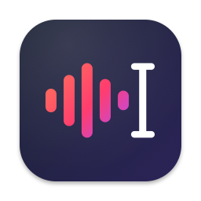
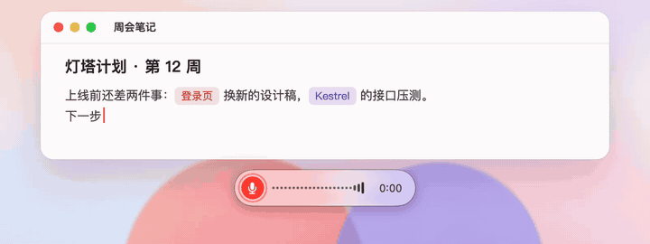
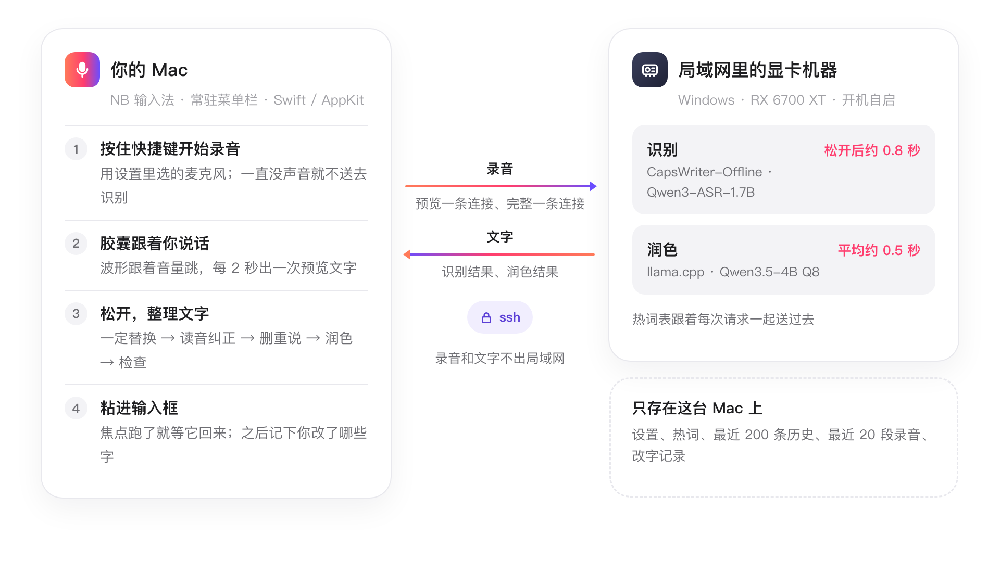
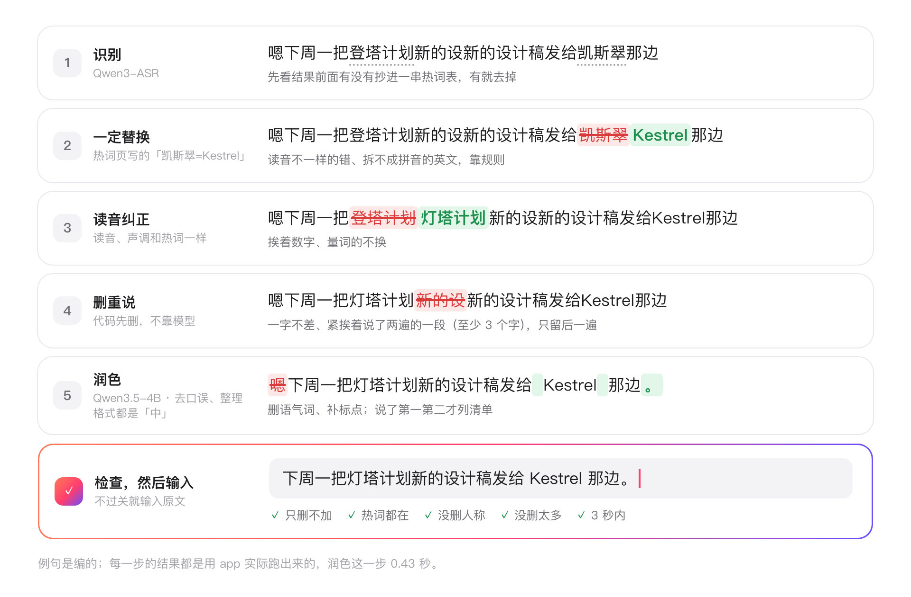
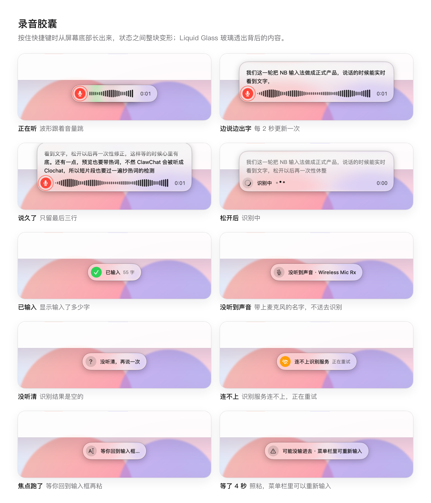
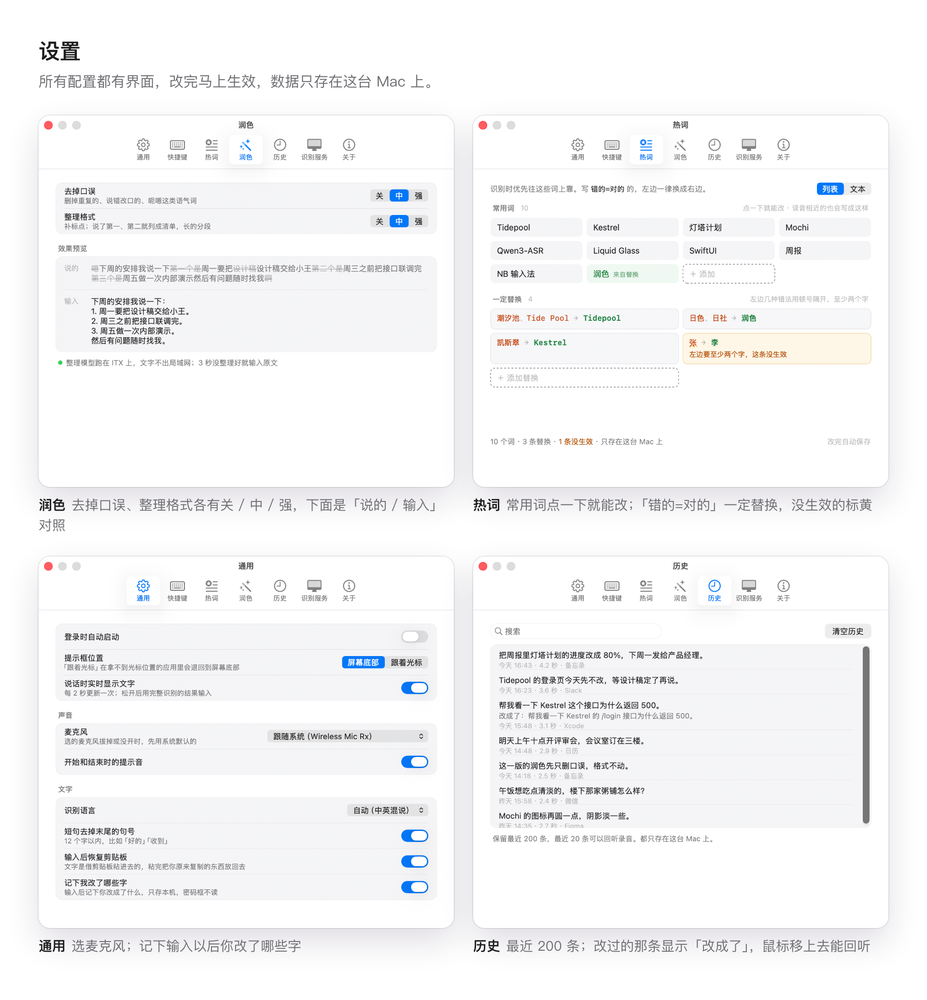

<p align="center">
  
</p>

<h1 align="center">NB 输入法</h1>

<p align="center">
  按住说话，松开输入。一款只为我自己的环境打造的 Mac 语音输入法。<br>
  <b>它不是拿来就用的产品，而是一份可以交给 AI 的上下文。</b>
</p>

<p align="center">
  <b>简体中文</b> · <a href="README.en.md">English</a> · <a href="README.ja.md">日本語</a>
</p>

<p align="center">
  
  
  
  
</p>

<p align="center">
  
</p>

## 软件要自己做

> 未来的工具不一定是一键安装的成品，而是一份可以交给 AI 的上下文。

做 NB 输入法有两个目标，分先后：

1. **首要：给自己打造一款最顺手的输入法。** 它只为我的环境服务：一台 Mac，加上局域网里一台带显卡的机器跑识别；说话中英混着来，常提到一堆自己项目里的专有名词。每一轮迭代都是因为我自己用着哪里不顺手，而不是为了把它变成一个值得发布的产品。我会一直按自己的想法改下去。
2. **其次：把做出来的东西当作上下文分享出来。** 拿去直接用多半跑不起来。但如果你也想做一款自己的语音输入法，可以把这个仓库交给你的 AI 编程工具（Claude Code、Codex、Cursor……），让它参照这里的决定、实测数据和踩过的坑，按**你的**环境做一个**你的**版本。

所以请把它当参考资料，而不是软件。

## 为什么不用现成的免费语音输入法

市面上免费的语音输入法已经很好用了，我还是自己搭了一套，原因有两个：

- **隐私。** 录音和文字只在自己家的局域网里走，不上传到任何人的服务器。
- **在我的工作环境里，自己搭的服务体验更好，也更稳定。** 识别跑在一台只为我服务的显卡机器上，不排队、不限流，也不受外网波动影响：松开后约 0.8 秒出完整结果，润色平均再加约 0.5 秒。热词表里是我自己项目的名字，快捷键和润色力度也都按我的习惯调。

线上产品要服务成千上万的人，只能在规模、成本和体验之间找平衡，照顾大多数人的平均需求。NB 输入法不用做这道取舍题：它只服务我一个人，每个选择都只看我用着顺不顺手。

## 它是怎么工作的

客户端只管录音、显示和输入；识别和润色都在局域网里的一台显卡机器上，经 ssh 隧道连过去，录音和文字都不出家门。

<p align="center">
  <picture>
    <source media="(prefers-color-scheme: dark)" srcset="design/readme/arch-zh-dark.png">
    
  </picture>
</p>

识别结果不直接粘贴，先在 Mac 上过几道处理，每一步都写进日志。下面这句是编的，但每一步的结果都是 app 实际跑出来的：

<p align="center">
  <picture>
    <source media="(prefers-color-scheme: dark)" srcset="design/readme/pipeline-zh-dark.png">
    
  </picture>
</p>

## 长什么样

<p align="center">
  <picture>
    <source media="(prefers-color-scheme: dark)" srcset="design/readme/capsule-states-zh-dark.png">
    
  </picture>
</p>

<p align="center">
  <picture>
    <source media="(prefers-color-scheme: dark)" srcset="design/readme/settings-zh-dark.png">
    
  </picture>
</p>

菜单栏图标本身就是状态：录音变红、识别中轮流亮、连不上变灰。菜单里最新一条点一下就重新输入一次，「最近识别」里的点了是复制。

「设置 › 通用 › 声音」可开启「说话时压低正在播放的声音」（默认关）：按下热键即后台检测，有其它 App 输出时用约 0.15 秒降到 0，不等开麦或长按确认，并跳过本次开始提示音；没压音量时提示音照常。结束时抬音量播放结束提示音，再用 1.25 秒渐进恢复。播放进度继续，不控制播放器。做法与实测见[实现记录](docs/2026-11-05-duck-volume.md)。

## 把它当上下文用

**只想先有一个能用的？** 打开你的 AI 编程工具（Claude Code、Codex、Cursor……），把这段整个发给它，仓库它会自己 clone：

```text
https://github.com/libin1528/nb-ime 是别人只为自己做的 Mac 语音输入法
（按住快捷键说话，松开输入）。请先把它 clone 到本地，再按里面的
docs/setup-with-agent.md 帮我在这台 Mac 上搭一个能用的版本：
先读它和 README，一次把要问我的问清楚，再替我选一条最省事的路
（没有显卡机就用 macOS 自带的离线识别），编译、配置、自己验证每一步，
只有授权和按快捷键这类必须我亲手做的事再交给我。
```

没有显卡机也行：macOS 26 自带的离线识别支持普通话、粤语和英语，那份引导里写了怎么接进来。

想按自己的想法改出一个自己的版本，就这样说：

```text
https://github.com/libin1528/nb-ime 是别人给自己做的 Mac 语音输入法。
先 clone 到本地，读 README、docs/ 和 git log，
弄清楚每个功能为什么这么做、踩过哪些坑。然后帮我做一个适合我自己的版本：
识别想跑在 ____，我常说的语言是 ____，我最想要的功能是 ____。
```

推荐的阅读顺序，人和 AI 都适用：

| 先读 | 里面有什么 |
|---|---|
| [`docs/setup-with-agent.md`](docs/setup-with-agent.md) | 给 AI 看的搭建引导：先问什么、选哪条路、每一步怎么确认、常见的坑 |
| [`docs/`](docs/) | 每一轮的开工单和记录：拍了什么板、实测的数据和结论、踩过的坑 |
| `git log` | 每一笔提交都写清改了什么、为什么改，连起来就是这个项目怎么一步步长出来的 |
| [`design/`](design/) | 交互稿，每一轮改前改后的截图，润色的前后对照页 |
| [`client-mac/Sources/`](client-mac/Sources/) | 按功能分文件的 Swift 代码，见下面的「可以借鉴什么」 |
| [`server/`](server/) | 服务端怎么部署、怎么开机自启，以及 Windows 上的坑 |

## 我的环境

先弄清它是照什么环境写的，才知道哪些要换成你自己的：

| | 我的 | 你多半要换掉 |
|---|---|---|
| 客户端 | macOS 26，原生 Swift / AppKit，常驻菜单栏，没有第三方依赖 | 系统版本（胶囊用了 Liquid Glass） |
| 识别 | 局域网里一台 Windows 显卡机器（RX 6700 XT），跑 [CapsWriter-Offline](https://github.com/HaujetZhao/CapsWriter-Offline) + Qwen3-ASR-1.7B | 识别跑在哪：本机、云端接口、别的模型 |
| 连接 | Mac 经 ssh 隧道连过去，录音不出家门 | 直连局域网，或者干脆不要服务端 |
| 润色 | 同一台机器上用 llama.cpp 跑 Qwen3.5-4B 8bit | 要不要润色、用哪个模型 |
| 麦克风 | 一只 USB 无线麦，设置里指定用它 | 你的麦克风；收音太小时识别会明显变差 |
| 说话习惯 | 中英混说，专有名词多，靠热词表兜着 | 你的语言、你的词表 |
| 界面语言 | 只有中文 | — |

## 可以借鉴什么

| 功能 | 代码 | 值得看的地方 |
|---|---|---|
| 录音胶囊 | [`Capsule.swift`](client-mac/Sources/Capsule.swift) | 系统的 `NSGlassEffectView`（clear 玻璃，文字下垫一层反色薄底）；从一颗圆长成胶囊，状态之间整块连续变形；波形跟着音量跳，说话时向上展开实时出字 |
| 全局快捷键 | [`Hotkey.swift`](client-mac/Sources/Hotkey.swift) | 用 CGEventTap 同时听键盘和鼠标：单按修饰键、F 键、鼠标侧键都能当快捷键，可以设两个；系统停用钩子后按实际按键状态重新对齐 |
| 录音和麦克风 | [`Audio.swift`](client-mac/Sources/Audio.swift) · [`Recordings.swift`](client-mac/Sources/Recordings.swift) | 可以跟随系统或指定麦克风，插拔自动刷新；`AVAudioEngine` 只认建它时的设备，换了设备就重建。一直没声音（低于 -55 dB）就不送去识别；最近 20 段录音存成 wav，历史里能回听 |
| 流式预览 | [`AppController.swift`](client-mac/Sources/AppController.swift) | 同一段录音走两条 WebSocket：一条每 2 秒出一次预览，一条松开后出完整结果，用完整结果输入 |
| 热词和「一定替换」 | [`WordsPane.swift`](client-mac/Sources/WordsPane.swift) · [`Replace.swift`](client-mac/Sources/Replace.swift) | 热词页默认是可以点着改的列表，也能切成一行一个的文本；写 `错的=对的` 就是一定替换，按整词、长的先匹配、只换一遍，写错的规则当场标黄说为什么 |
| 热词按读音纠正 | [`Hotfix.swift`](client-mac/Sources/Hotfix.swift) | 模型写成「万三」，读音和热词「Wan3」一样就换回来；中文要声调也一样，挨着数字、量词的不换 |
| 防模型抄热词表 | [`Settings.swift`](client-mac/Sources/Settings.swift) 的 `strippedEcho` | 整句都是热词就倒序热词再认一遍；真话前面抄了一串（从第一个热词起按原顺序连着 4 个以上）就把那段去掉 |
| 识别后润色 | [`Polish.swift`](client-mac/Sources/Polish.swift) | 「去掉口误」「整理格式」各有关 / 中 / 强三档。一字不差的重说先用代码删掉，不交给模型；不信任小模型的输出，过一遍「只删不加、热词都在、没删人称、没删太多」的检查，不过关就输入原文 |
| 粘贴前对焦点 | [`AppController.swift`](client-mac/Sources/AppController.swift) | 按下快捷键时记下焦点；粘之前焦点换到了不能打字的地方，就等它回来（最多 4 秒），菜单栏里还能重新输入一次 |
| 改字记录 | [`Edits.swift`](client-mac/Sources/Edits.swift) | 粘贴后用辅助功能接口盯着那个输入框，记下你把这段字改成了什么，只存本机，给以后的优化攒数据；密码框不读，Electron 应用先请它打开辅助功能树 |
| 菜单栏、设置、引导 | [`MenuBar.swift`](client-mac/Sources/MenuBar.swift) · [`SettingsWindow.swift`](client-mac/Sources/SettingsWindow.swift) · [`Onboarding.swift`](client-mac/Sources/Onboarding.swift) | 菜单栏图标本身就是状态：录音变红、识别中轮流亮、连不上变灰；所有配置都有界面 |

## 实测过的结论，踩过的坑

这些在代码里只是一两行，背后都是一次实测或者一次翻车，详细的在 [`docs/`](docs/) 和提交记录里：

- **服务端的音频缓存按连接分，不按任务分。** 预览和完整识别必须各开一条 WebSocket，挤在一条上录音会混在一起，完整结果变成空的。
- **人声太弱或者一直没说话时，识别模型会把提示里的热词表原样念出来。** 要检测出来，把热词倒过来排再认一遍复核。预览也会这样，可预览不带热词的话专有名词又会错，两头都得管。录音开头声音弱时，它还会把整张表抄在真话前面（同一段录音认 20 次有 3 次），也要拦。
- **「识别变差」多半是收音的问题，不是模型。** 无线麦发射器没开或离得远时，接收器只送静音；调好以前说话最响 -47 dB，调好以后 -30 dB 左右，错字跟着没了。所以没声音就别送，胶囊直接说「没听到声音」并带上麦克风名字，录音也存下来能回听。
- **`AVAudioEngine` 只认建它时的那个设备**，系统换了默认麦克风它也不跟，要重建并显式指定；tap 要用麦克风自己的 `inputFormat`，输入输出采样率不一致时用 `outputFormat` 会直接抛异常；关麦时先停引擎再拆 tap，反过来会崩。
- **预览的片段长度 2 秒是平衡点：** 比说话慢 1 到 1.5 秒；3 秒更准，但更新太慢。
- **`NSEvent` 的全局监听收不到单按的修饰键**，改用 CGEventTap。AI 模拟的按键会被系统丢掉，快捷键只能人手按，再看日志判断对不对。
- **重新编译以后「辅助功能」授权会丢**，用钥匙串里固定的开发证书签名就不丢；换 bundle id 也会丢。
- **clear 玻璃不垫底，浅色模式下深色背景上的字看不清。** `tintColor` 几乎不起作用，最后自己垫了一层反色薄底。
- **小模型润色偶尔会补字、改字。** 与其在提示词上死磕，不如在输出端做机械检查：加了字、丢了热词、删了人称、删得太多、超时，一律退回原文。能用代码确定做好的事（一字不差的重说）就别交给模型。
- **模拟一次 ⌘V 的那一刻，焦点不在输入框就落空了**，用户只看到「已输入」却什么都没有。要在按下时记住焦点、粘之前对一下。
- **Electron 应用默认不开辅助功能树**，读不到输入框里的字；对它设一次 `AXManualAccessibility` 再读。
- **llama.cpp 在 Windows 上不加 `--no-mmap`**，一个 4B 模型要占 5.7GB 内存，加了只占 834MB。
- **Windows 上 `schtasks /end` 只结束主进程**，识别子进程会变成孤儿继续占显存，重启几次显卡就满了、识别从 0.4 秒变成几秒。计划任务默认优先级是 7（低于正常），机器一忙识别就被挤到后面、内存先被换出，要设成 2。

## 想自己跑一遍

<details>
<summary>照我的环境跑：一台带显卡的机器跑识别服务、macOS 26，自己编译。展开看步骤（没有显卡机就交给 AI 照 <code>docs/setup-with-agent.md</code> 做）。</summary>

<br>

1. **服务端**：在一台有显卡的机器上装 CapsWriter-Offline 和 Qwen3-ASR 模型，见 [`server/README.md`](server/README.md)（我们的是 Windows）。识别后润色要再跑一个 Qwen3.5-4B，同一份说明里有；不跑也行，到「设置 › 润色」里把两项都关掉。
2. **客户端**：需要 macOS 26 和 Xcode 命令行工具。
   ```bash
   cd client-mac && ./build.sh
   ```
   装到 `~/Applications/NB 输入法.app` 并启动。想重编以后不用重新授权「辅助功能」，在 `client-mac/sign-identity.local` 里写一行你钥匙串里开发证书的名字；没有就用临时签名。
3. 第一次打开会引导你开麦克风和辅助功能权限；再到「设置 › 识别服务」里填你的 ssh 主机或服务器地址（默认值是照我们自己的机器写的）。

这是我自己的工具：不接需求，不承诺维护，issue 不一定回。更建议的做法是 fork 一份，或者让你的 AI 照着它重新写一个。

</details>

<details>
<summary>目录、本地数据和调试命令</summary>

<br>

| 目录 | 内容 |
|---|---|
| `client-mac/` | Mac 菜单栏客户端（Swift / AppKit，`Sources/` 下按功能分文件）。`./build.sh` 编译、装好并启动；`--no-run` 只装不启动，`--icon` 重画图标 |
| `server/` | 服务端（CapsWriter-Offline 和润色模型）的部署说明和 Windows 自启脚本 |
| `tools/` | 调试脚本，比如测流式预览的 `stream_test.py`、对比热词提示写法的 `hotword_echo_test.py` |
| `design/` | 交互稿 `mockup.html`，每一轮实际界面的对照截图，润色前后对照页 `polish/samples.html`，热词页交互稿 `hotwords/`，首页的图和它们的源文件 `homepage/`（`src/render.sh` 重新渲染） |
| `docs/` | 每一轮的开工单和记录 |

客户端的本地数据都在 `~/Library/Application Support/NBIME/`：设置 `config.json`、热词 `hotwords.txt`、历史 `history.json`（最近 200 条），都能在设置窗口里改；最近 20 段录音在 `recordings/`，改字记录在 `edits/edits.jsonl`（改过的那几段录音另存在 `edits/`，最多 300 段）。日志在 `~/Library/Logs/NBIME.log`，替换、纠正、删重说、润色、焦点等了多久，每一步都记一行。

调试：

- `NBIME --test-file <音频>`：不用麦克风，按实时节奏走一遍同样的发送路径（含流式预览），打印 `PREVIEW` / `RESULT`。
- `NBIME --demo <界面>`：截图用，`listen` `quiet` `preview` `long` `think` `done` `miss` `offline` `nosound` `morph`（录变形用的一整套）`menu` `onboarding` `settings:0`…`settings:6`。
- `NBIME --polish-test <文件>`：文件里一行一句，每句按润色的 8 种档位组合各跑一遍，一行一个 JSON（`--levels 中中,强强` 只跑这几种）。改提示词前后都跑一遍对比。
- `NBIME --edit-test <刚输入的字> [--seconds N]`：假装刚把这段字粘进了焦点输入框，盯 N 秒后把改字结果写进日志，不进记录。要用 `open -g -n -a` 启动装好的 app（辅助功能权限认的是 app）。
- 这几种模式会借用已经开着的隧道，不动它。

</details>

## 用到的开源项目

| 项目 | 用在哪 | 协议 |
|---|---|---|
| [CapsWriter-Offline](https://github.com/HaujetZhao/CapsWriter-Offline) | 识别服务端，客户端按它的 WebSocket 协议通信 | MIT |
| [Qwen3-ASR](https://github.com/QwenLM/Qwen3-ASR) | 语音识别模型（1.7B，q5_k 量化版随 CapsWriter 的模型包发布） | Apache-2.0 |
| [Qwen3.5-4B](https://huggingface.co/Qwen/Qwen3.5-4B) | 识别后润色的小模型（用 [unsloth](https://huggingface.co/unsloth/Qwen3.5-4B-GGUF) 的 Q8_0 量化） | Apache-2.0 |
| [llama.cpp](https://github.com/ggml-org/llama.cpp) | 跑润色模型的 `llama-server`（用 CapsWriter 自带的 Vulkan 版） | MIT |
| [websockets](https://github.com/python-websockets/websockets)、[NumPy](https://github.com/numpy/numpy) | `tools/` 里的调试脚本 | BSD-3-Clause |

这些都没有打包进本仓库，要用的话按各自的协议去原项目下载。设计上参考了 Apple 的 Liquid Glass 和微信输入法的菜单。

## 协议

[MIT](LICENSE)。代码、文档、截图都可以随便拿去改，不用打招呼。
