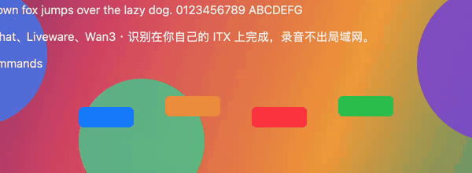
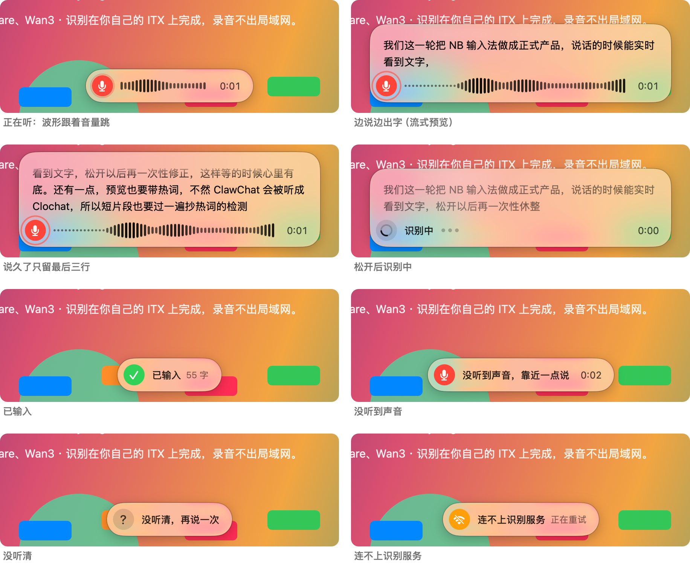
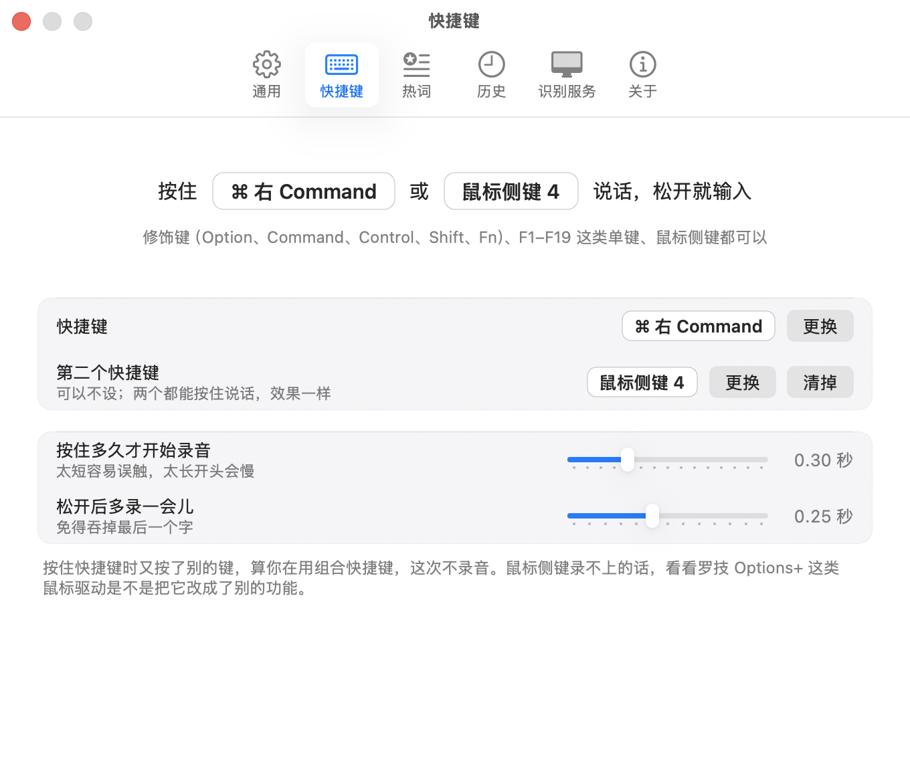

# NB 输入法

一个只给自己用的 Mac 语音输入小工具：按住快捷键说话，屏幕底部的胶囊里边说边出字，松开后整句文字直接进到当前输入框。识别跑在自己局域网里的一台显卡机器上，录音不出家门。

<p align="center"></p>

> **English**: A push-to-talk voice input tool for macOS that we built for ourselves. Speech recognition runs on our own LAN GPU box ([CapsWriter-Offline](https://github.com/HaujetZhao/CapsWriter-Offline) + Qwen3-ASR), not in the cloud. It is **not** a product: no installer, no support, Chinese UI only, and it assumes a setup most people don't have. We publish it mainly as a **UI reference** for a native AppKit menu-bar app with a Liquid Glass (`NSGlassEffectView`) recording capsule. Feel free to borrow anything (MIT).

## 先把预期放低

这是我们为自己的使用习惯做的工具，**不适合拿来直接用**：

- **识别不在你的 Mac 上。** 需要你自己另有一台带显卡的机器，跑 [CapsWriter-Offline](https://github.com/HaujetZhao/CapsWriter-Offline) 的服务端（我们用 RX 6700 XT 跑 Qwen3-ASR-1.7B），Mac 通过 ssh 隧道或局域网连过去。没有这台机器，它什么也做不了。
- **只支持 macOS 26 及以上**（胶囊用了系统的 Liquid Glass）。
- **没有安装包、没有签名发布、没有自动更新**，要自己编译。
- **界面只有中文**，默认设置是照我们自己的机器写的（比如 ssh 主机名），装好要先在设置里改成你的。
- **不承诺维护。** 有问题欢迎提 issue，但不一定回；需求基本不接。

## 那为什么开源

主要是给想做类似东西的人一个**前端界面的参考**。整个客户端是原生 Swift / AppKit，没有第三方依赖，下面这些都可以直接翻代码看：

- **录音胶囊**（`client-mac/Sources/Capsule.swift`）：系统的 `NSGlassEffectView`（clear 玻璃 + 一层托字的薄底），从一颗圆长成胶囊，状态之间整块连续变形；波形跟着音量跳，说话时向上展开实时显示文字。
- **菜单栏 + 设置窗口 + 首次引导**（`MenuBar.swift`、`SettingsWindow.swift`、`Onboarding.swift`）：菜单图标本身就是状态（录音变红、识别中轮流亮、连不上变灰）。
- **全局快捷键**（`Hotkey.swift`）：用 CGEventTap 听键盘和鼠标，单按修饰键、F 键、鼠标侧键都能当快捷键，可以同时设两个。
- **流式预览**（`AppController.swift`）：同一段录音走两条 WebSocket 连接，一条每 2 秒出一次预览，一条松开后出完整结果。
- **热词按读音换写法**（`Hotfix.swift`）：模型写成「万三」，读音和热词「Wan3」一样就换回来。
- **识别后润色**（`Polish.swift`）：松开后、输入前用同一台机器上的小模型（Qwen3.5-4B）整理一遍：去掉口误、整理格式各有 关 / 中 / 强。小模型偶尔会乱改，结果要过一遍「只删不加、热词都在」的检查，不过关就输入原文。

觉得哪部分有用，拿去改就好，不用打招呼。

## 长什么样

<p align="center"></p>

<p align="center"></p>

更多改前改后的对照截图在 [`design/`](design/)，每一轮做了什么、踩了什么坑在 [`docs/`](docs/)。

## 如果你还是想跑起来

1. **服务端**：在一台有显卡的机器上装 CapsWriter-Offline 和 Qwen3-ASR 模型，见 [`server/README.md`](server/README.md)（我们的是 Windows）。识别后润色要再跑一个 Qwen3.5-4B，同一份说明里有；不跑也行，到「设置 › 润色」里两项都关掉。
2. **客户端**：需要 macOS 26 和 Xcode 命令行工具。
   ```bash
   cd client-mac && ./build.sh
   ```
   装到 `~/Applications/NB 输入法.app` 并启动。想重编以后不用重新授权「辅助功能」，在 `client-mac/sign-identity.local` 里写一行你钥匙串里开发证书的名字；没有就用临时签名。
3. 第一次打开会引导你开麦克风和辅助功能权限；再到「设置 › 识别服务」里填你的 ssh 主机或服务器地址。

## 目录

| 目录 | 内容 |
|---|---|
| `client-mac/` | Mac 菜单栏客户端（Swift / AppKit，`Sources/` 下按功能分文件）。`./build.sh` 编译、装好并启动；`--no-run` 只装不启动，`--icon` 重画图标 |
| `server/` | 服务端（CapsWriter-Offline）的部署说明和 Windows 自启脚本 |
| `tools/` | 调试脚本，比如测流式预览的 `stream_test.py`、对比热词提示写法的 `hotword_echo_test.py` |
| `design/` | 交互稿 `mockup.html`，以及每一轮实际界面的对照截图 |
| `docs/` | 每一轮的开工单和记录 |

客户端的本地数据都在 `~/Library/Application Support/NBIME/`：设置 `config.json`、热词 `hotwords.txt`、历史 `history.json`（最近 200 条），都能在设置窗口里改。日志在 `~/Library/Logs/NBIME.log`。

调试：
- `NBIME --test-file <音频>`：不用麦克风，按实时节奏走一遍同样的发送路径（含流式预览），打印 `PREVIEW` / `RESULT`。
- `NBIME --demo <界面>`：截图用，`listen` `quiet` `preview` `long` `think` `done` `miss` `offline` `morph`（录变形用的一整套）`menu` `onboarding` `settings:0`…`settings:6`。
- `NBIME --polish-test <文件>`：文件里一行一句，每句按润色的 8 种档位组合各跑一遍，一行一个 JSON（`--levels 中中,强强` 只跑这几种）。改提示词前后都跑一遍对比，对照页 `design/polish/samples.html` 就是它的结果。
- 这几种模式会借用已经开着的隧道，不动它。

## 用到的开源项目

| 项目 | 用在哪 | 协议 |
|---|---|---|
| [CapsWriter-Offline](https://github.com/HaujetZhao/CapsWriter-Offline) | 识别服务端，客户端按它的 WebSocket 协议通信 | MIT |
| [Qwen3-ASR](https://github.com/QwenLM/Qwen3-ASR) | 语音识别模型（1.7B，q5_k 量化版随 CapsWriter 的模型包发布） | Apache-2.0 |
| [Qwen3.5-4B](https://huggingface.co/Qwen/Qwen3.5-4B) | 识别后润色的小模型（用 [unsloth](https://huggingface.co/unsloth/Qwen3.5-4B-GGUF) 的 Q8_0 量化） | Apache-2.0 |
| [llama.cpp](https://github.com/ggml-org/llama.cpp) | 跑润色模型的 `llama-server`（用 CapsWriter 自带的 Vulkan 版） | MIT |
| [websockets](https://github.com/python-websockets/websockets)、[NumPy](https://github.com/numpy/numpy) | `tools/` 里的调试脚本 | BSD-3-Clause |

这些都没有打包进本仓库，要用的话按各自的协议去原项目下载。设计上参考了 Apple 的 Liquid Glass 和微信输入法的菜单。

## 协议

[MIT](LICENSE)。
